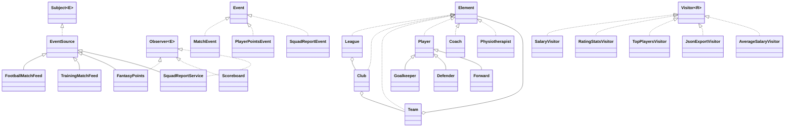

# LiveSports

LiveSports is a Java 17 Maven demonstration of Observer and Visitor in a football match. It has no runtime dependencies. JUnit 5 is the only test dependency.

## Design decisions

The Observer uses a push model: each publisher passes an immutable event to subscribed listeners. This keeps listeners independent of a mutable data source and gives each handler the exact occurrence it must process. Subscriptions are separate for each event type. A concurrent map and copy-on-write lists allow publishers and runtime subscription changes to work together. A handler may remove itself; the current delivery uses the list snapshot.

The composite tree performs traversal. League, Club, and Team call `accept` on their children. Visitors only handle each element, so a visitor can focus on its calculation or output. The `end` hooks let JSON close each container after its children.

`Main` creates the domain tree, feeds, listeners, and subscriptions. Producers use a configurable executor and wait for submitted work to finish. A red card starts a report on just the affected team's subtree.

## Run

Use JDK 17 and Maven 3.9 or newer.

```sh
mvn test
mvn exec:java -Dexec.args="3"
```

The number of producer threads is the optional argument and must be at least 3. Open the `pom.xml` in IntelliJ IDEA to import the Maven project.

## UML



## Trade-off proof

### New visitor

Commit `Add AverageSalaryVisitor` changed only `src/main/java/visitor/AverageSalaryVisitor.java`. No element class changed. Adding a new operation costs one new visitor class with a method for each existing element type.

### New element type

Commit `Add Physiotherapist element` changed `src/main/java/model/Physiotherapist.java`, `src/main/java/visitor/Visitor.java`, `src/main/java/visitor/SalaryVisitor.java`, `src/main/java/visitor/RatingStatsVisitor.java`, `src/main/java/visitor/TopPlayersVisitor.java`, `src/main/java/visitor/JsonExportVisitor.java`, `src/main/java/visitor/AverageSalaryVisitor.java`, `src/test/java/LiveSportsTest.java`, and `README.md`. Adding an element costs a new class plus a new method in the Visitor interface and every visitor implementation. The tests and README verify and record that cost.

## AI Log
